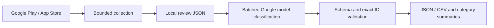

# App Review Insights

Collect Google Play and App Store reviews, classify feedback with a Google generative model, and produce category and component summaries for product analysis.

This project grew from a notebook workflow used to analyze mobile-app feedback. The portfolio edition separates collection, model calls, validation, and reporting into reusable Python modules, while retaining a clean notebook walkthrough.

## What it does

- Fetches a bounded set of recent Android reviews and paginated iOS RSS reviews.
- Assigns one of four categories: **Talep** (request), **Hata** (reported bug), **Şikayet** (complaint), or **Hata ya da Şikayet değil** (other feedback).
- Adds a specific component/topic such as giriş, bildirimler, or TradingView.
- Uses structured JSON responses and validates every classification with Pydantic.
- Joins results by stable review ID, preserving input text and order. Missing, duplicate, or unknown IDs fail validation.
- Produces detailed JSON/CSV exports and category counts, percentages, and topic counts.
- Includes an offline demo with eight entirely synthetic reviews and manually assigned fixture labels.



## Quick start: offline demo

Python 3.10+ is recommended.

```sh
python -m venv .venv
source .venv/bin/activate
pip install -r requirements.txt
python cli.py demo
```

The demo uses pre-labelled fixtures, makes no API calls, and needs no key. It demonstrates the reporting pipeline; it does **not** measure model accuracy.

Expected category counts:

| Category | Count | Percentage |
| --- | ---: | ---: |
| Talep | 2 | 25.0% |
| Hata | 3 | 37.5% |
| Şikayet | 2 | 25.0% |
| Hata ya da Şikayet değil | 1 | 12.5% |

Reports are saved to ignored `reports/demo/`. The [notebook walkthrough](notebooks/app_review_analysis.ipynb) uses the same synthetic fixtures.

## Collect reviews

Replace the placeholders with your own public app identifiers:

```sh
python cli.py collect --platform android --app-id YOUR_ANDROID_PACKAGE --limit 100 --output data/android_reviews.json
python cli.py collect --platform ios --app-id YOUR_NUMERIC_APP_STORE_ID --pages 1 --output data/ios_reviews.json
```

Collection language and storefront are configurable with `--language` and `--country`; the defaults are `tr` and `tr`. Android collection is capped at 1,000 requested reviews per run; iOS permits 1–10 feed pages and defaults to one. These sources are not guaranteed to expose all historical reviews. Provider changes, throttling, and storefront differences may affect availability. Collection errors are surfaced rather than treated as successful empty exports.

The normalized JSON format is:

```json
[{"review_id":"demo-001","platform":"Android","date":"2026-01-01","rating":1,"text":"Uygulama giriş ekranında kapanıyor."}]
```

Collectors omit author names, profile URLs, and developer replies. Review text may still contain personal information; inspect and redact it before cloud analysis.

## Analyze your reviews with AI

```sh
cp .env.example .env
# Set GOOGLE_API_KEY and REVIEW_MODEL in your local .env.
python cli.py analyze data/android_reviews.json --batch-size 20 --output reports/android
```

Choose a model available to your account that supports structured JSON output. No model name is hardcoded: the original notebook used provider model names that may change. `GEMMA_API_KEY` is accepted as a legacy environment variable, but the client uses Google's generative API; the variable name does not determine which model runs.

This command sends only review IDs and text to Google, and may incur API charges. Review metadata stays local. API errors and invalid/incomplete labels stop the run before report writing. There is no automatic retry or silent positional/fuzzy matching. Treat categories as analyst suggestions: their correctness is not established by JSON validation.

Outputs:

- `classified_reviews.json`: original fields plus validated category and topic.
- `classified_reviews.csv`: spreadsheet-friendly detailed report; formula-like text is escaped for CSV export.
- `summary.json`: category counts/percentages and topic counts within each category.

Original review text is preserved in JSON. Topic strings are model-generated and are counted literally; there is no cross-batch topic taxonomy or automatic semantic merging.

## Language configuration

Collection language and storefront are configurable. The included model prompt, output category labels, and synthetic examples use Turkish. Adapt the prompt and output-label schema for other reporting languages, then evaluate classification quality on representative reviews. This repository does not include a multilingual accuracy benchmark.

## Tests

```sh
python -m unittest discover -s tests -v
```

Tests use synthetic fixtures and mocked model/store clients. They cover reordered labels, missing/duplicate/unknown IDs, schema failures, batching, summaries, CSV formula handling, and iOS feed parsing. Offline validation does not establish live store availability or model classification quality.

## Privacy and provenance

No original review spreadsheets, notebook outputs, company-specific app identifiers, API keys, or local machine paths are included. Published examples are synthetic. Keep local data under ignored `data/` and `reports/` and do not commit your `.env`.

Compared with the original notebook, this edition removes positional and fuzzy matching, replaces company-specific filenames with generic inputs, moves date/rating metadata into a shared schema, and adds reproducible reporting. It does not claim that the original project already contained these improvements.
